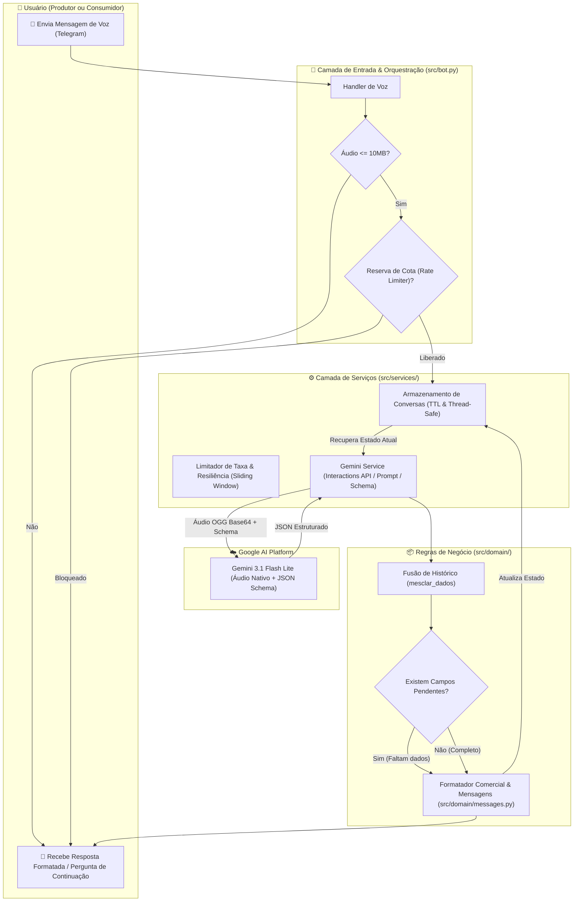

# 🌾 Chatbot Feira Digital — Assistente Comercial Inteligente

> **Projeto de Iniciação Científica** voltado a conectar agricultores familiares e consumidores locais por meio de processamento multimodal de áudio com a API **Google Gemini** e o **Telegram**.

[](LICENSE)
[](https://www.python.org/)
[](https://ai.google.dev/)
[](https://github.com/eternnoir/pyTelegramBotAPI)

---

## 📌 Sobre o Projeto

Na agricultura familiar, muitos produtores e clientes encontram dificuldades ao interagir com formulários complexos ou interfaces textuais tradicionais. 

O **Chatbot Feira Digital** resolve essa barreira ao permitir que os agricultores anunciem suas safras e os compradores façam pedidos **apenas enviando mensagens de voz no Telegram**. 

O sistema utiliza o modelo de inteligência artificial generativa **Gemini 3.1 Flash Lite** (via **Interactions API** da Google) com suporte a áudio nativo para transcrever, interpretar intenções comerciais, extrair entidades e conduzir diálogos estruturados de forma incremental.

---

## 🏗️ Arquitetura da Solução

O fluxo de processamento foi desenhado com foco em desacoplamento, segurança de dados e alta resiliência contra limites de cota da API:



---

## 📂 Estrutura de Pastas

O projeto adota uma arquitetura em camadas clara e modular:

```text
chatbot-feira-digital/
├── docs/                        # Imagens, esquemas complementares e documentações
├── src/                         # Código-fonte da aplicação
│   ├── domain/                  # Regras de negócio e modelos da feira
│   │   ├── __init__.py
│   │   ├── models.py            # Normalização de dados, validação de schema e mesclagem de turnos
│   │   └── messages.py          # Formatação visual das mensagens em BRL e perguntas direcionadas
│   ├── services/                # Serviços de infraestrutura e integrações externas
│   │   ├── __init__.py
│   │   ├── gemini_service.py    # Integração multimodal com o SDK google-genai
│   │   ├── rate_limiter.py      # Controle de vazão por minuto/usuário e retentativas exponenciais
│   │   └── state_manager.py     # Gerenciamento de sessões em memória com TTL e proteção LRU
│   ├── __init__.py
│   ├── bot.py                   # Handlers e ciclo de vida do bot do Telegram
│   └── config.py                # Configurações de ambiente, limites e parâmetros do modelo
├── tests/                       # Suíte de testes automatizados
│   ├── __init__.py
│   └── test_comercial.py        # Testes unitários para regras de negócio e limites
├── .env.example                 # Modelo de variáveis de ambiente (sem credenciais)
├── .gitignore                   # Regras de proteção para arquivos sensíveis e ambientes
├── LICENSE                      # Licença de uso não-comercial (CC BY-NC 4.0)
├── main.py                      # Ponto de entrada para execução do serviço
├── README.md                    # Documentação do projeto
└── requirements.txt             # Dependências Python do projeto
```

---

## 🌟 Principais Funcionalidades

1. **Entrada por Voz Exclusiva**: Processamento direto de áudios em formato OGG/Opus enviados pelo Telegram.
2. **Extração Multimodal Estruturada**: Utiliza a `Interactions API` da Google GenAI com esquema JSON rígido, evitando alucinações e garantindo tipos corretos.
3. **Conversação com Memória Incremental**:
   - Se o usuário não informar o preço ou a quantidade de um item no primeiro áudio, o assistente pergunta especificamente pelo dado que falta.
   - Suporte a múltiplos produtos em um mesmo áudio com identificação isolada.
   - Suporte a preços por unidade, por lote ou a combinar (negociável).
4. **Resiliência e Proteção contra Estouro de Cota**:
   - Janela deslizante de requisições por minuto e por usuário.
   - Detecção de erro `429 (Resource Exhausted)` com suspensão temporária automática para evitar bloqueios na API.
5. **Gerenciamento de Sessão Thread-Safe**:
   - Estados das conversas armazenados com tempo de expiração configurável (TTL de 30 min) e expiração automática de conversas inativas.

---

## 🚀 Como Executar Localmente

### 1. Pré-requisitos
- Python 3.10 ou superior.
- Token de Bot do Telegram (obtido gratuitamente com o [@BotFather](https://t.me/BotFather)).
- Chave de API do Google Gemini (obtida gratuitamente no [Google AI Studio](https://aistudio.google.com/app/apikey)).

### 2. Clonar o Repositório
```bash
git clone https://github.com/Victorozana/chatbot-feira-digital.git
cd chatbot-feira-digital
```

### 3. Criar e Ativar o Ambiente Virtual
```bash
# Windows
python -m venv venv
venv\Scripts\activate

# Linux / MacOS
python3 -m venv venv
source venv/bin/activate
```

### 4. Instalar as Dependências
```bash
pip install -r requirements.txt
```

### 5. Configurar as Variáveis de Ambiente
Copie o arquivo de exemplo e insira suas credenciais:
```bash
# Windows
copy .env.example .env

# Linux / MacOS
cp .env.example .env
```
Edite o arquivo `.env`:
```env
TELEGRAM_TOKEN=coloque_seu_token_do_telegram_aqui
GEMINI_API_KEY=coloque_sua_chave_do_gemini_aqui
```

### 6. Executar o Bot
```bash
python main.py
```

---

## 🧪 Executando os Testes Automatizados

O projeto conta com suíte de testes unitários para validar a lógica de parsing, mescla de informações e controle de concorrência:

```bash
python -m unittest discover tests
```

---

## 📄 Licença e Termos de Uso (Não-Comercial)

Este projeto está licenciado sob os termos da **Creative Commons Atribuição-NãoComercial 4.0 Internacional (CC BY-NC 4.0)**.

- ✅ **Você pode**: Compartilhar, copiar, estudar, executar e adaptar o código para fins acadêmicos, de pesquisa, estudo pessoal ou portfólio.
- ❌ **Você NÃO pode**: Vender, comercializar, alugar, sublicenciar ou utilizar este projeto direta ou indiretamente para obtenção de vantagem comercial ou compensação monetária.

Consulte o arquivo [`LICENSE`](LICENSE) para mais detalhes.

---

<p align="center">
  Desenvolvido por <strong>Victor Ozana</strong> no âmbito de Iniciação Científica 🚀
</p>
